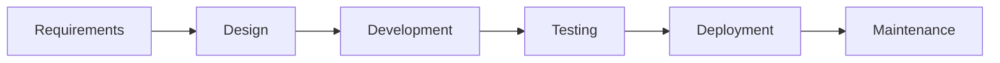

# Regulars SDLC and sprint backlog

Regulars is a solo Kotlin and Jetpack Compose loyalty app: a restaurant list, a stamp card, reward rules, favourites, and an offline cache. One developer, about one week per sprint. Core features come first. Extras stay in the Sprint 7 backlog.

Coding starts at Sprint 1. Sprint 0 is this backlog: scope, stories, and the tech constraints below.

## Definition of done

A task is done when all three are true:

- It matches its acceptance line.
- `./gradlew test` passes for the logic it touches.
- The change is one meaningful git commit.

## SDLC

Agile lifecycle. Each sprint sits in a named phase.

- **Requirements** — Sprint 0. Scope, user stories, acceptance lines, definition of done.
- **Design** — Sprint 1. Packages, navigation, data model, reward rules, API contract.
- **Development** — Sprints 2–5. Data layer, home, stamps and rewards, favourites, offline, settings.
- **Testing and deployment** — Sprint 6. ViewModel and Compose tests, CI, README.
- **Maintenance** — Sprint 7 backlog. QR stamp, notification, stats, home-screen widget.

## Audiences

Regulars is a stamp card for people who eat at the same places often. Two readers matter:

- A diner collecting stamps and claiming a reward such as a free coffee.
- An interviewer reading the code for MVVM, a repository, Room, and tested business rules.

## Scope

**Core**

- Restaurant list loaded from a REST API.
- Restaurant detail and an 8-stamp card.
- Reward rules, including one stamp per restaurant per hour.
- My cards (favourites) and bottom navigation.
- Offline Room cache.
- Settings: theme and reset.

**Extras (Sprint 7 only)**

- QR stamp (CameraX and ML Kit).
- WorkManager nudge when a card is close to a reward.
- Stats screen.
- Jetpack Glance home-screen widget.

## Core user stories

Each story has one acceptance line. Later sprints implement these lines.

- **List cards.** As a diner, I see every restaurant from the API so I can pick where to collect stamps. Acceptance: each card shows the name, cuisine, a small image, and stamp progress such as “5 / 8”.
- **Search and filters.** As a diner, I narrow the list by name and cuisine. Acceptance: the search bar filters by name, and chips narrow by cuisine (Café, Pizza, Asian, and the cuisines in the mock data).
- **Reward ready.** As a diner, I notice a finished card immediately. Acceptance: restaurants with a full card sort first and show a “Reward ready!” badge.
- **Refresh.** As a diner, I reload the list from the API. Acceptance: pull-to-refresh replaces the list with the latest API data.
- **List states.** As a diner, I always know whether the list is working. Acceptance: loading shows a spinner, error shows a message plus “Try again”, and an empty result shows a short friendly message.
- **Detail.** As a diner, I open one restaurant and see how to visit it. Acceptance: the header shows name, cuisine, address, and opening hours.
- **Stamp card.** As a diner, I see how close I am to a reward. Acceptance: a grid of 8 circles fills in as stamps are collected.
- **Add visit.** As a diner, I record a visit and see it in history. Acceptance: “Add visit” plays a short fill animation, shows a Snackbar (“Stamp added – 3 more to your reward!”), and lists visits newest first with date and time.
- **Cooldown.** As a diner, I can add only one stamp per restaurant per hour. Acceptance: during the cooldown the button is disabled and shows the remaining time, for example “You can add another stamp in 42 min”.
- **Claim reward.** As a diner, I claim a reward when the card is full and start again. Acceptance: at 8 stamps, “Claim reward” shows the reward text (for example “Free coffee”); confirming in a dialog records the claim in history and resets the card to 0.
- **Favourite.** As a diner, I keep the places I actually use. Acceptance: a heart icon adds or removes that restaurant from My cards.
- **My cards tab.** As a diner, I switch between every restaurant and my saved cards. Acceptance: bottom navigation has “All restaurants” and “My cards”, and My cards lists only favourites.
- **Offline.** As a diner, I can still open saved restaurants with no network. Acceptance: if the network call fails and Room still has restaurants, a banner reads “Offline – showing saved data”; stamps, visits, and favourites stay local only.
- **Theme.** As a diner, I choose light or dark. Acceptance: Settings toggles light and dark with Material 3 dynamic colours.
- **Reset.** As a diner, I can wipe local stamps and favourites on purpose. Acceptance: “Reset all data” asks for confirmation, then clears local Room data.

## Tech constraints

- Language and UI: Kotlin, Jetpack Compose, Material 3.
- Architecture: MVVM plus repository, single-activity with Navigation Compose.
- State: ViewModel plus StateFlow, and a `UiState` sealed class (`Loading`, `Success`, `Error`).
- Async: Kotlin coroutines and Flow.
- Network: Retrofit plus Kotlinx Serialization, with a mock JSON API.
- Local data: Room tables for restaurants, visits, and favourites.
- Dependency injection: Hilt.
- Testing: unit tests for reward rules, the one-stamp-per-hour rule, and ViewModels; one or two Compose UI tests.
- Code quality: ktlint, git commits with a clear message, and a GitHub Actions workflow that runs the tests.

## Sprint 0 — Requirements

**Phase:** Requirements.

**Goal:** Freeze what done means before any Android project exists.

- **S0-T1.** Write the product one-liner and the two audiences: a diner collecting stamps, and an interviewer reading the code. See [Audiences](#audiences).
- **S0-T2.** Split scope into core and extras. See [Scope](#scope).
- **S0-T3.** Turn each core feature into a user story with one acceptance line. See [Core user stories](#core-user-stories).
- **S0-T4.** Record the tech constraints: Kotlin, Compose, Material 3, MVVM plus repository, Navigation Compose, StateFlow and a `UiState` sealed class, Retrofit, Room, Hilt, coroutines, ktlint, GitHub Actions. See [Tech constraints](#tech-constraints).

**Exit:** Core vs extra is explicit, and every core story has an acceptance line.

## Sprint 1 — Design and project foundation

**Phase:** Design.

**Goal:** An empty app that compiles, with the business rules already tested.

- **S1-T1.** Create a single-activity Compose app. Packages: `data`, `domain`, and `ui`.
- **S1-T2.** Add Navigation Compose, Hilt, Room, Retrofit, Kotlinx Serialization, and coroutines.
- **S1-T3.** Sketch the navigation graph: All restaurants, My cards, restaurant detail, Settings.
- **S1-T4.** Define `Restaurant`, `Visit`, and `Favourite`. Restaurant fields: name, cuisine, image URL, address, opening hours, reward text (for example “Free coffee”).
- **S1-T5.** Put reward rules in plain Kotlin, with unit tests first: 8 stamps unlocks the reward, claiming records the claim and resets the card to 0, and only one stamp per restaurant per hour.
- **S1-T6.** Write the mock JSON contract those screens will load.
- **S1-T7.** Add ktlint and a GitHub Actions workflow that runs unit tests on push.

**Exit:** `./gradlew test` is green for the reward rules, and the app launches to an empty shell.

## Sprint 2 — Data layer

**Phase:** Development.

**Goal:** Restaurants load from the mock API and survive a failed network call.

- **S2-T1.** Retrofit service for the mock JSON API.
- **S2-T2.** Room tables and DAOs for restaurants, visits, and favourites.
- **S2-T3.** Repository: a network load writes restaurants into Room; a failed call reads the cache. Stamps, visits, and favourites are local only.
- **S2-T4.** `UiState` sealed class: `Loading`, `Success`, `Error`.

**Exit:** A repository test, or a small manual check, shows cached restaurants when the network call fails.

## Sprint 3 — Home

**Phase:** Development.

**Goal:** The list a diner actually opens.

- **S3-T1.** Restaurant cards: name, cuisine, small image, stamp progress such as “5 / 8”. Acceptance: [List cards](#core-user-stories).
- **S3-T2.** Search by name, and cuisine chips. Acceptance: [Search and filters](#core-user-stories).
- **S3-T3.** Full cards sort first, with a “Reward ready!” badge. Acceptance: [Reward ready](#core-user-stories).
- **S3-T4.** Pull-to-refresh. Acceptance: [Refresh](#core-user-stories).
- **S3-T5.** Three states: spinner, error with “Try again”, and a short empty message. Acceptance: [List states](#core-user-stories).

**Exit:** Search, chips, sort, refresh, and the three states match their acceptance lines.

## Sprint 4 — Detail, stamps, and rewards

**Phase:** Development.

**Goal:** The stamp card and the one-stamp-per-hour rule.

- **S4-T1.** Detail header: name, cuisine, address, opening hours. Acceptance: [Detail](#core-user-stories).
- **S4-T2.** Grid of 8 circles that fill as stamps are collected. Acceptance: [Stamp card](#core-user-stories).
- **S4-T3.** “Add visit”: short fill animation, Snackbar (“Stamp added – 3 more to your reward!”), visit history newest first with date and time. Acceptance: [Add visit](#core-user-stories).
- **S4-T4.** During the one-hour cooldown, disable the button and show remaining time, for example “You can add another stamp in 42 min”. Acceptance: [Cooldown](#core-user-stories).
- **S4-T5.** At 8 stamps, show “Claim reward” plus the reward text. Confirm in a dialog, record the claim in history, and reset the card to 0. Acceptance: [Claim reward](#core-user-stories).

**Exit:** The reward unit tests still pass, and the detail screen follows them.

## Sprint 5 — Favourites, offline, settings

**Phase:** Development.

**Goal:** The rest of the core product.

- **S5-T1.** Heart icon saves a restaurant to My cards. Acceptance: [Favourite](#core-user-stories).
- **S5-T2.** Bottom navigation: “All restaurants” and “My cards”. Acceptance: [My cards tab](#core-user-stories).
- **S5-T3.** If the network fails and Room still has restaurants, show “Offline – showing saved data”. Acceptance: [Offline](#core-user-stories).
- **S5-T4.** Settings: light/dark toggle with Material 3 dynamic colour, and “Reset all data” behind a confirmation dialog. Acceptance: [Theme](#core-user-stories) and [Reset](#core-user-stories).

**Exit:** A diner can favourite a place, use the app from cache, switch theme, and wipe local data on purpose.

## Sprint 6 — Testing and release

**Phase:** Testing and deployment.

**Goal:** The core app is something to show in an interview.

- **S6-T1.** ViewModel tests for the list, adding a stamp, and claiming a reward.
- **S6-T2.** One or two Compose UI tests: list states, or the stamp button and the cooldown message.
- **S6-T3.** Confirm the GitHub Actions workflow runs those tests.
- **S6-T4.** README: what Regulars is, how to run it, and where the reward rules live.

**Exit:** Core scope from Sprint 0 is in the app, tests pass in CI, and the README is enough for a reviewer.

## Sprint 7 — Maintenance backlog

**Phase:** Maintenance.

Start this only after Sprint 6. One extra per task, each its own commit. These tasks are outside the core release.

- **S7-T1.** QR stamp with CameraX and ML Kit.
- **S7-T2.** WorkManager local notification when a card is one stamp away and that restaurant has not been visited in a week.
- **S7-T3.** Stats: total visits, rewards earned, and the most-visited restaurant.
- **S7-T4.** Jetpack Glance widget for the card closest to a reward.

**Exit:** Each extra works on its own and does not change the core reward rules.

## Build order

Sprint 1 is the first coding sprint. Build Sprints 1 through 6 in order. Open Sprint 7 only after Sprint 6’s exit check is met.
